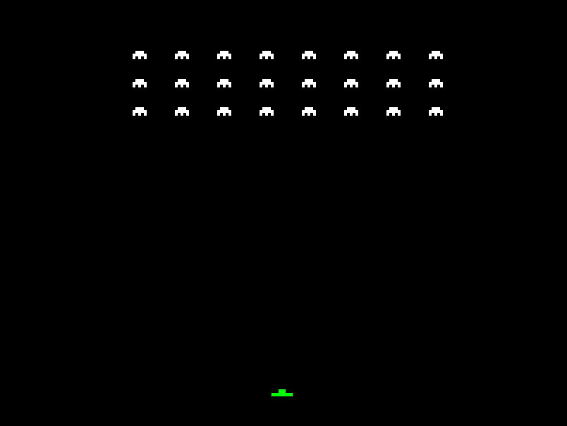

# The Redux Kernel

### WAZAHHH WELCOME TO REDUX :D

Redux is a hobby x86_64 operating system made by a very sleep-deprived secondary schooler in his bedroom.

yes.

an actual operating system.

no i dont know why either.

It was originally supposed to be a DOS replacement.

**A DOS REPLACEMENT.**

AND NOW IT HAS RING 3, PAGING, INTERRUPTS, ELF LOADING AND A WHOLE LOT OF OTHER STUFF I SOMEHOW MANAGED TO IMPLEMENT.

HOW DID WE GET HERE 😭

anyways welcome to Redux.

pls enjoy your stay and try not to cause a triple fault.

## 👾 LOOK WHAT I MADE



**SPACE INVADERS.**

**IN RING 3.**

**WAZAHHHHHHHHHHHHH**

yes, that is an actual userspace program.

yes, it runs on MY kernel.

no, it isn't just the kernel drawing some rectangles and pretending to be a game.

well technically it IS drawing rectangles.

BUT THROUGH SYSCALLS.

FROM RING 3.

**OH YEA.**

The kernel runs in Ring 0 and the game runs in Ring 3.

This means the game can't just casually access privileged kernel memory.

at least thats the idea.

pls dont try to break it.

actually you can.

just tell me what happened afterwards :P

## 🤔 Why Redux?

idk.

operating systems are cool.

I originally wanted to make a DOS replacement, but apparently my brain decided that wasn't complicated enough.

so now we're here.

Redux is for people who enjoy:

- computers
- more computers
- assembly
- C
- staring at hexadecimal numbers
- debugging something for 5 hours only to discover a missing `*`
- QEMU
- watching the CPU have a complete meltdown
- making things that nobody asked for
- accidentally creating a 64-bit operating system
- suffering the consiquences

If you like any of these things, congratulations!

you have found the correct repository.

probably.

## 🚧 Current status

**ALPHA**

yes.

we have an alpha release.

NO IT IS NOT FINISHED.

NO IT IS NOT STABLE.

YES IT BOOTS.

YES IT RUNS PROGRAMS.

**YES IT RUNS SPACE INVADERS.**

Here's what currently exists:

| Feature | Status |
|---|---|
| x86_64 Long Mode | WORKS :D |
| GDT | exists |
| IDT | also exists |
| Interrupts | THE CPU HAS BEEN INTERRUPTED |
| Paging | memory go brrrr |
| Ring 3 | WAZAHHH IT WORKS |
| ELF64 loading | YES |
| SYSCALL | IT ACTUALLY WORKS |
| Shell | type stuff here |
| Framebuffer | PIXELS |
| APIC | interrupts but fancier |
| exFAT through FatFS | files :D |
| Limine | boots the thing |
| USB keyboard | nope |
| PS/2 keyboard | YES |
| Multitasking | not yet |
| Stability | lol |

also btw

**RING 3 IS OFFICIALLY WORKING AS INTENDED.**

This took a while.

There were bugs.

There were exceptions.

There were probably several moments where the CPU questioned my programming abilities.

BUT IT WORKS NOW.

so thats nice.

## 🧠 How does this thing even work

Redux is a 64-bit operating system.

It uses the x86_64 architecture, which is basically x86 but with more bits and more opportunities to make mistakes.

The kernel runs in Ring 0.

Userspace programs run in Ring 3.

Why?

because letting every program have full control over the computer sounds like a very bad idea.

Redux has a syscall interface that allows userspace programs to request services from the kernel.

For example, Space Invaders uses syscalls to draw stuff on the framebuffer.

so basically:

```text
SPACE INVADERS
      |
      v
   SYSCALL
      |
      v
REDUX KERNEL
      |
      v
 FRAMEBUFFER
      |
      v
  PIXELS :D
```

and somehow the CPU agrees to do all of this.

thank you CPU.

very cool.

## 👾 HOW TO RUN SPACE INVADERS

OKAY SO.

You want to run Space Invaders.

very nice.

heres how.

### 1. Get a disk image

You need a disk image formatted as **exFAT**.

NOT FAT12.

NOT FAT16.

NOT FAT32.

**exFAT.**

Redux uses FatFS to access the disk.

If you format it incorrectly, FatFS will probably look at your disk and go:

"what"

and then refuse to cooperate.

You can use the included Python utility:

`reduximg.py`

to prepare your disk image and copy `INVADERS.ELF` onto it.

### 2. ATTACH THE DISK

THIS IS IMPORTANT.

Attach the disk image to QEMU or your VM **BEFORE BOOTING REDUX**.

Otherwise Redux won't be able to find it.

because the disk isn't there.

because you didn't attach it.

pls attach the disk.

### 3. Boot Redux

boot the thing.

hopefully you get the shell.

if you dont, something has gone horribly wrong.

or maybe something very slightly wrong.

idk check the logs.

### 4. RUN THE THING

Type:

```text
run INVADERS.ELF
```

and press Enter.

AND THEN...

**SPACE INVADERS SHOULD APPEAR.**

hopefully.

it works on my machine :D

### 5. IMPORTANT KEYBOARD THING

Redux currently uses PS/2 keyboard input.

USB keyboard support isn't implemented yet.

why?

**SCHOOL.**

I HAVE SCHOOL.

I CANNOT SPEND EVERY WAKING MOMENT IMPLEMENTING USB CONTROLLERS.

unfortunately.

QEMU emulates a PS/2 keyboard, so you should be fine there.

Physical hardware hasn't been tested yet.

so if you somehow get Redux running on an actual computer...

**PLEASE TELL ME.**

i wanna know.

## 📁 Project structure

```text
Redux/
├── docs/               # documentation and stuff
│   └── index.md
├── limine/             # bootloader things
├── programs/           # ELF programs live here
├── src/                # THE KERNEL
├── GNUmakefile         # make
├── Makefile            # also make
├── README.md           # hello you are here
├── linker.lds          # linker wizardry
├── limine.conf         # limine configuration
├── redux.iso           # THE ISO
├── invaders.png        # proof that it works
├── reduximg.py         # disk image thingy
├── LICENSE             # legal stuff
└── ...                 # other stuff
```

yes the repository is a bit chaotic.

no i am not explaining every file.

some of them are probably older than the features they support.

## 🔨 Building Redux

You need:

- an x86_64 cross compiler
- GNU Make
- QEMU
- Limine
- patience
- more patience
- even more patience

Then run:

```sh
make
```

and hope.

If everything works, you should get a bootable image.

If it doesn't work...

well.

welcome to OS development.

**YOU HAVE BEEN INITIATED.**

Please check your compiler, dependencies, and build configuration before reporting issues.

because sometimes it really is just the toolchain.

## ⚠️ Known limitations

okay so.

Redux is NOT finished.

please understand this.

Things that currently don't work or haven't been implemented:

- USB keyboard support
- Multitasking
- Various hardware drivers
- Probably other things I haven't discovered yet

Physical hardware hasn't been tested.

Also there are probably bugs.

actually there are DEFINITELY bugs.

I just haven't found all of them.

**DO NOT USE THIS AS YOUR MAIN OPERATING SYSTEM.**

I AM SERIOUS.

IT IS AN ALPHA.

If you try to use Redux to write your homework and lose everything because of a kernel panic, that is between you and the CPU.

## 📚 Documentation

There is actual documentation!

yes really.

go to:

`docs/index.md`

This contains information about the architecture and development of Redux.

Some of it is serious.

Some of it is not.

I tried.

## 🤖 AI usage

okay so before anyone asks.

**NO, AI DID NOT WRITE THE KERNEL.**

I write the code myself.

AI is only used for things like:

- explaining confusing concepts
- helping debug weird problems
- understanding documentation
- translating old x86 documentation into something my brain can process

thats it.

I want to actually understand how my operating system works.

If Redux crashes because I made a stupid mistake, I want that mistake to be **MY** stupid mistake.

thank you very much.

## 🤝 Contributing

WANT TO CONTRIBUTE?

YAY :D

Pull requests are welcome.

If you want to make a major change, please open an issue first.

I don't want to wake up one morning and discover someone has replaced the entire memory manager with a Minecraft redstone computer.

actually that would be impressive.

BUT STILL.

Please test your changes.

Please explain what they do.

And please don't deliberately introduce triple faults.

**Don't be shy to submit a pull request and suffer the consiquences!**

The consiquences include:

- debugging
- code review
- more debugging
- wondering why something doesn't work
- realizing it was a missing semicolon
- MORE DEBUGGING

anyways have fun :D

## ⚖️ License

Redux is licensed under the **GNU GPLv3** unless otherwise noted.

See `LICENSE`.

pls follow the license.

thank you.

## 💀 Final note

sooooo.

Redux was originally supposed to be a DOS replacement.

A SMALL DOS REPLACEMENT.

SOMETHING SIMPLE.

AND NOW LOOK AT IT.

IT HAS A 64-BIT KERNEL.

IT HAS PAGING.

IT HAS INTERRUPTS.

IT HAS RING 3.

IT HAS SYSCALLS.

IT HAS GROWN TENTICALS

**IT RUNS SPACE INVADERS.**

WHAT.

I made this in my bedroom.

while going to school.

with homework.

and other stuff.

and somehow it became an actual operating system.

I DON'T EVEN KNOW ANYMORE.

but hey.

it works.

mostly.

hopefully.

:D

---

### Redux Kernel

**Made by a sleep-deprived secondary schooler who probably should have picked an easier hobby.**

if you like it, feel free to star the repo.

if you don't like it, thats fine too.

if it crashes, pls open an issue.

if it triple faults...

**WAZAHHH YOU FOUND A BUG!!!**

anyways.

**byeeeee :D**
